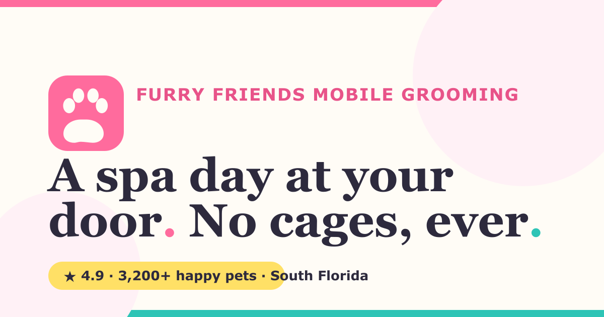

# Furry Friends — Mobile Pet Grooming Website

**🌐 Frontend Project · Local Service Business Website**

**Ovais Godil · Full Stack Developer**




A conversion-focused website for a mobile dog and cat grooming business in South Florida, with service and pricing pages, location pages, a blog and a multi-step instant-quote booking wizard.

## ✨ Features

- Multi-step **quote / booking wizard** with client-side validation and webhook submission
- Service, pricing, locations, FAQ, about and blog pages
- Contact form with timeout handling and graceful error states
- SEO: sitemap, meta tags, Open Graph images and clean URLs
- Built with Astro for fast, mostly static pages

## 🧰 Tech stack

- Astro
- JavaScript
- CSS

## 🚀 Run locally

This repository contains the production build of the site (static HTML, CSS, JS and assets). Serve it locally with:

```bash
npx serve .
```

## 👤 Author

**Ovais Godil** — Full Stack Software Developer
[Hire me on Freelancer.com](https://www.freelancer.com/u/OvaisGodil1) · [GitHub](https://github.com/Ovais-Arif)
